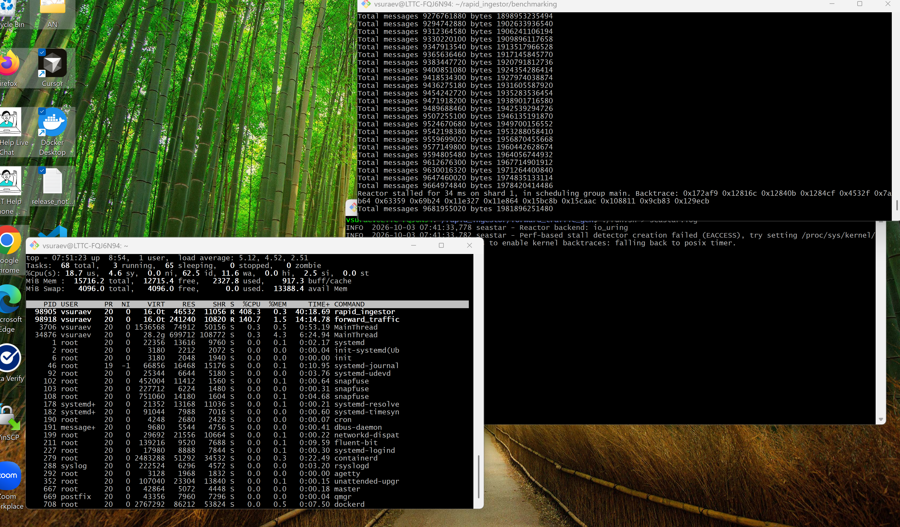
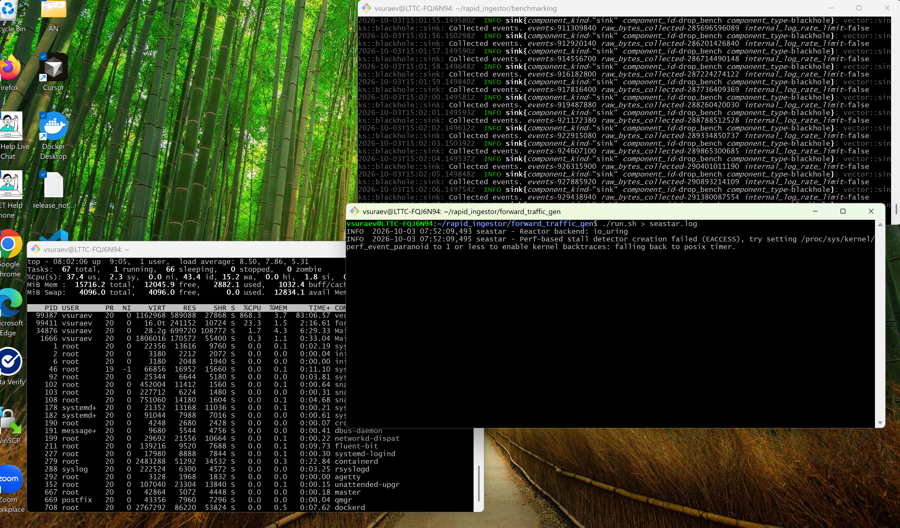
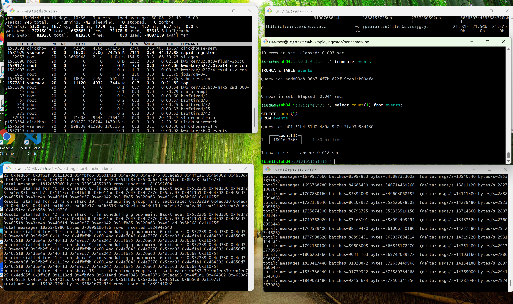
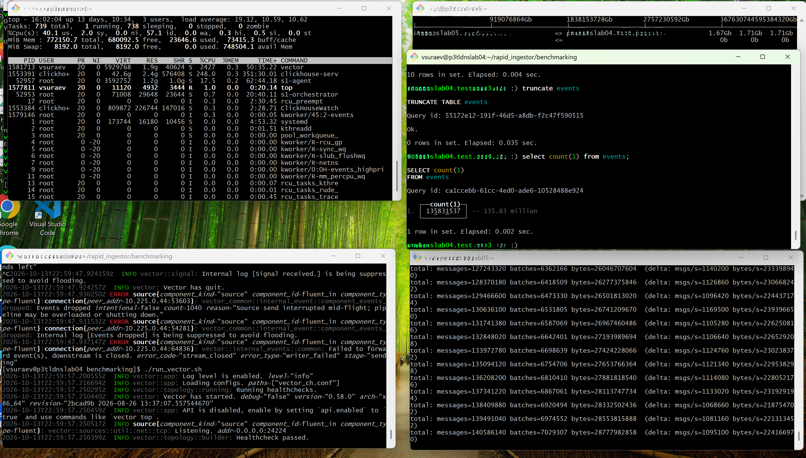
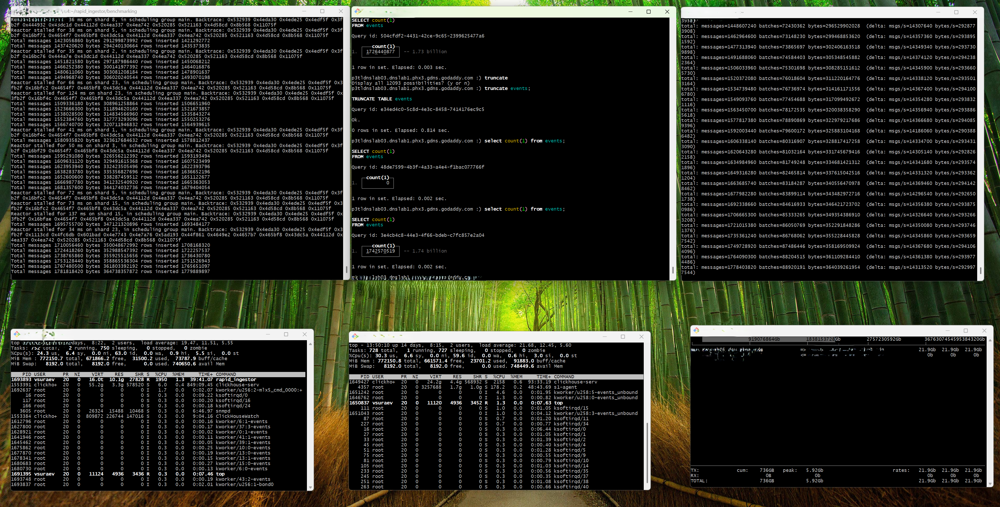
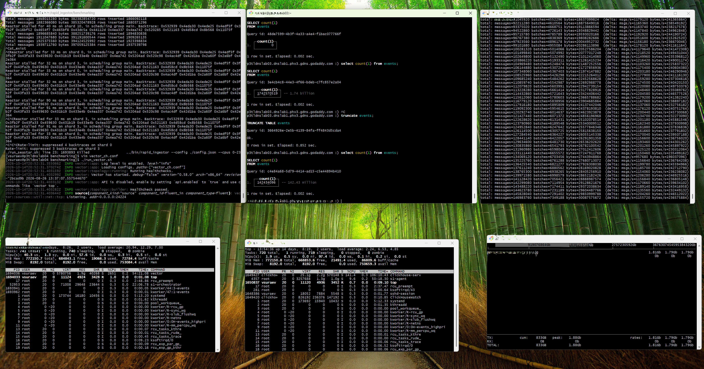

# Benchmarking: rapid_ingestor vs Vector

Two separate benchmarks were run, both comparing `rapid_ingestor` against
[Vector](https://vector.dev/) as a Fluent Forward (msgpack) receiver:

1. **Forward-protocol receive path only** (`forward_traffic_gen/`) - a
   seastar-based synthetic client hammers the server over the Fluent Forward
   protocol with no sink/output and no field manipulation, isolating raw
   accept+parse throughput.
2. **End-to-end ClickHouse ingestion** (`benchmarking/`) - `fluent-bit`
   clients feed the server, which in turn writes into ClickHouse, measuring
   real-world row throughput into the database.

Topology differs between runs:
- The no-sink forward_traffic_gen WSL2 run has client and server **on the
  same host**, talking over loopback (127.0.0.1).
- The no-sink forward_traffic_gen bare-metal run uses **two separate
  physical machines**: one running the `forward_traffic_gen` generator, the
  other running `rapid_ingestor`/`vector` - traffic goes over the real NIC,
  not loopback.
- The ClickHouse-sink runs (section 2) use that same **two-bare-metal**
  topology: one machine runs the `fluent-bit` generator, the other runs
  ClickHouse plus `rapid_ingestor`/`vector`.

## 1. Forward-protocol receive path (forward_traffic_gen)

Client: `forward_traffic_gen --host 127.0.0.1 --port 24224 -c 8 --connections 8
--entries-per-batch 20 --fields 6 --field-size 24`, target: `rapid_ingestor`
or `vector` listening on the same TCP port with no further output configured.

Run in two setups: **WSL2 (Ubuntu 24.04)**, client and server on the same
host over loopback, and **bare metal Ubuntu**, client and server on two
separate physical machines over the network.

### WSL vs bare metal (10+ minute runs)

| Tool            | Environment | Duration | Total messages | Total bytes | Avg msgs/s | Avg throughput |
|-----------------|-------------|---------:|----------------:|------------:|-----------:|---------------:|
| rapid_ingestor  | WSL2        | ~10.2 min | 950,521,440     | 194.6 GB    | 1.56 M/s   | 318 MB/s |
| rapid_ingestor  | bare metal  | ~10.2 min | 8,782,600,220   | 1.80 TB     | 14.37 M/s  | 2.94 GB/s |
| vector          | WSL2        | ~10.5 min | 551,861,940     | 113.0 GB    | 0.88 M/s   | 179 MB/s |
| vector          | bare metal  | ~10.2 min | 709,282,680     | 145.2 GB    | 1.16 M/s   | 238 MB/s |

(source: `forward_traffic_gen/rapid_ingestor_bm`, `rapid_ingestor_baremetal_bm`,
`vector_bm`, `vector_baremetal_bm`)

Takeaways:
- Bare metal vs WSL2: `rapid_ingestor` is **~9.2x** faster on bare metal than
  under WSL2; `vector` only gains **~1.3x**. `rapid_ingestor`'s receive path
  (seastar/epoll, TCP_QUICKACK) is far more sensitive to WSL2's
  Hyper-V-virtualized loopback network stack than Vector's networking stack
  (see repo memory notes on WSL2 TCP-loopback overhead).
- `rapid_ingestor` vs `vector`: **~1.8x** faster under WSL2, **~12.4x** faster
  on bare metal.

### Final run snapshot (bare metal, screenshot)

| Tool           | CPU usage | Total messages | Total bytes |
|----------------|----------:|----------------:|-------------:|
| rapid_ingestor | 408%      | 9,664,974,840    | 1.978 TB |
| vector         | 868%      | 929,438,940      | 291.4 GB |

`rapid_ingestor` processed **~10.4x** more messages than Vector while using
**less than half** the CPU (408% vs 868%).

### Additional short trial (8-core, separate runs)

Two shorter standalone trials per tool (8 cores), kept as a secondary data
point alongside the longer runs above:

| Tool           | Run | Duration | Total messages | Total bytes | Avg msgs/s |
|----------------|-----|---------:|----------------:|------------:|-----------:|
| rapid_ingestor | 1   | ~6.5 min | 9,378,163,380   | 1.92 TB     | 24.2 M/s |
| rapid_ingestor | 2   | ~1.4 min | 2,008,315,260   | 411.1 GB    | 24.8 M/s |
| vector         | 1   | ~2.4 min | 213,258,380     | 43.7 GB     | 1.51 M/s |
| vector         | 2   | ~0.9 min | 76,477,960      | 15.7 GB     | 1.42 M/s |

(source: `forward_traffic_gen/seastar8.log`, `seastar8_2.log`, `vector8.log`,
`vector8_2.log`)

## 2. End-to-end ClickHouse ingestion (benchmarking/)

Client: `fluent-bit` (`fluent-bit-client.conf`) streaming Forward-protocol
batches into either `rapid_ingestor` (native ClickHouse protocol sink,
`events.events` table) or Vector (`vector_ch.conf`, HTTP `TabSeparated` sink
into the same table). Same two-bare-metal topology as the forward_traffic_gen
bare-metal run above: `fluent-bit` runs on one machine, ClickHouse plus
`rapid_ingestor`/`vector` run on the other. Measured over a **2-minute** run
per tool: rows ingested via `SELECT count(1) FROM events` on the ClickHouse
CLI, CPU usage of the ingestor and of `clickhouse-server`, and network
bandwidth observed on the generator (fluent-bit client) machine.

| Tool           | Ingestor CPU | ClickHouse CPU | Rows ingested (2 min) | Generator bandwidth |
|----------------|-------------:|----------------:|-----------------------:|---------------------:|
| rapid_ingestor | 2110%        | 2770%           | 1.8 billion            | 21.9 GB/s |
| vector         | 2427%        | 248%            | 135.83 million         | 1.67 GB/s |

Takeaways:
- `rapid_ingestor` drove **~13.25x** more rows into ClickHouse in the same
  2-minute window, using *less* CPU on the ingestor process itself (2110% vs
  2427%) despite the far higher row rate.
- ClickHouse's own CPU usage (2770% vs 248%) shows that with `rapid_ingestor`
  feeding it, ClickHouse itself becomes the bottleneck - the native-protocol
  insert path pushes rows in much faster than the HTTP/TabSeparated path used
  by Vector's sink.

### Variant: 3-machine setup (generator / ingestor / ClickHouse each on their own box)

Same `fluent-bit` client and sinks as above, but this time the ingestor
(`rapid_ingestor`/`vector`) and ClickHouse each run on their own dedicated
bare-metal machine, separate from the generator - three machines total
instead of two. Measured the same way, over a 2-minute run per tool.

| Tool           | Ingestor CPU | ClickHouse CPU | Rows ingested (2 min) | Generator bandwidth |
|----------------|-------------:|----------------:|-----------------------:|---------------------:|
| rapid_ingestor | 1950%        | 2158%           | 1.74 billion           | 21.9 Gb/s |
| vector         | 2651%        | 141.4%          | 142.43 million         | 1.81 Gb/s |

Takeaways:
- Row throughput stays in the same ballpark as the 2-machine run for both
  tools (`rapid_ingestor` ~1.74B vs ~1.8B rows, `vector` ~142.4M vs ~135.8M
  rows) - separating the ingestor from ClickHouse onto its own machine
  doesn't meaningfully change the picture.
- `rapid_ingestor` still delivers **~12.2x** more rows than Vector in the
  same 2-minute window, while using noticeably less ingestor CPU (1950% vs
  2651%).
- With the ingestor on its own box, ClickHouse's CPU usage drops for both
  (2158% and 141.4% vs 2770% and 248% in the 2-machine setup) since it no
  longer shares a host with the ingestor process, but the same pattern
  holds: ClickHouse works much harder to keep up with `rapid_ingestor`'s
  native-protocol inserts than with Vector's HTTP/TabSeparated inserts.

## Notes

- See `/memories/repo/perf-investigation.md` for the investigation behind the
  WSL2 vs bare-metal gap (WSL2's Hyper-V virtual network stack adds
  significant per-packet overhead to TCP loopback vs native Linux loopback).
- All figures above are as observed during these specific runs on a single
  machine/VM pair; absolute numbers will vary with hardware, core counts and
  generator parameters, but the relative WSL-vs-bare-metal and
  rapid_ingestor-vs-Vector gaps were consistent across repeated runs.
